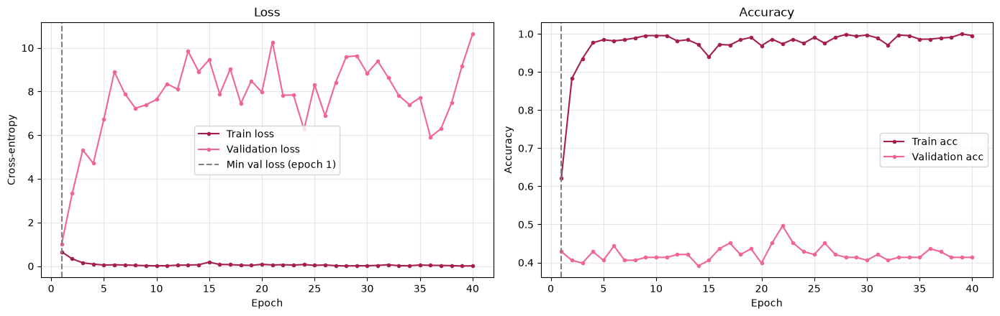
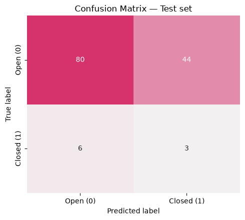

# EEG Eye State Classification with a 1D CNN

Classifying whether a person's eyes are **open or closed** from raw EEG signals, using a one-dimensional convolutional neural network built in PyTorch.

## Dataset

[EEG Eye State](https://archive.ics.uci.edu/dataset/264/eeg+eye+state) (UCI Machine Learning Repository): about 15,000 samples, 14 EEG channels, and a binary label (`eyeDetection`: 0 = open, 1 = closed).

The dataset file (`EEG Eye State.arff`) is included in this repo, next to the notebook.

## What the notebook does

1. **Load and explore** the data (class distribution, first channels over time, outliers).
2. **Preprocess**
   - Chronological 70/15/15 train/validation/test split (no random shuffling, to avoid data leakage).
   - Clip extreme outliers and standardize each channel, using statistics from the training set only.
   - Cut the signal into sliding windows of 128 samples (step 16); each window gets the label of its last sample.
3. **Model** (`EEG_CNN`): three `Conv1d -> BatchNorm1d -> ReLU -> MaxPool1d` blocks followed by two `Linear` layers (about 170k parameters).
4. **Train** for a fixed 40 epochs (no early stopping) and plot train/validation loss to see where overfitting starts.
5. **Evaluate** on the held-out test set with a classification report and confusion matrix.

## Results

- The model overfits very early: train accuracy reaches about 99% while validation accuracy stays around 40%, and validation loss rises from the first epochs.
- Test accuracy is 62%, but recall for the "closed" class is only 33% (the last 15% of the recording has only about 7% closed-eye windows, so accuracy alone is misleading).
- Likely reasons (not verified): very little training data (648 windows with heavy overlap) and the signal drifting over time, which matters with a chronological split.




## Run it

```bash
pip install -r requirements.txt
jupyter notebook EEG-CNN.ipynb
```

Run all cells top to bottom.
